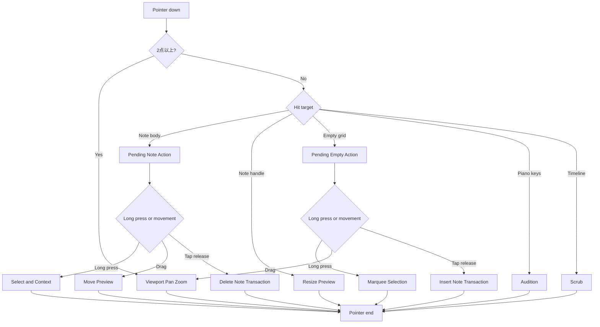

# 02 — タブレット操作仕様 / Interaction contract

**目的:** 直感的で、隠れた状態が少なく、ジェスチャーが衝突しないノートエディター。

## A. 統一ジェスチャー

| 始点 | 指の動き | コマンド | 確定 |
|---|---|---|---|
| ノートのないグリッド | 短くタップ | 既定長のノートを作成 | 離指 |
| 既存ノートの中央 | 短くタップ | ノート削除（暫定既定） | 離指 |
| 既存ノートの中央 | ドラッグ | 時間＋音高移動 | 離指 |
| ノート右端のハンドル | ドラッグ | 長さ変更 | 離指 |
| 既存ノート | 長押し | ノートを選択し小さなアクションメニュー | 長押し認識時 |
| グリッド空白 | ドラッグ | キャンバスをパン | 指の動きに追従 |
| グリッド空白 | 長押し→ドラッグ | 矩形で複数選択 | 離指 |
| 編集領域の任意位置 | 2本指の移動／ピンチ | パン／ズーム | 常時追従 |
| 左側ピアノ鍵盤 | 押下／なぞり | 音を試聴（録音モード以外は入力しない） | 押下中 |
| 上部タイムライン | タップ／ドラッグ | 再生位置移動 | 動作中 |
| 選択ノート群 | コンテキスト操作 | 複製／削除／移調／グループ化 | 明示操作 |

### 削除仕様の注意

元の要望を尊重し、タップ削除を試作の初期値とする。ただし最も重大な誤操作候補。**指を押した瞬間は消さず、離すときに初めて削除**する。押下中はハイライト表示。Undoは常設。誤削除率が選択方式より悪い場合は、メイン設計を変更して再検証する（設定が増えすぎることは避ける）。

### 複数操作の入口

基本操作には必ず視覚的代替を設ける: 長押しで編集メニュー、選択したノート群に削除／複製ボタン、時間目盛りから再生位置移動、上部再生ボタン、ペン利用時のキーボードショートカット（PC）。画面に常時ボタンを大量配置しない。

## B. 入力認識ステートマシン

- タップ／ドラッグのしきい値はCSS px固定にせず端末解像度・接触精度を考慮する。**具体値はプロトタイプで測定**し、デバイス別の誤認識を検証する。
- 長押しタイムアウトも測定で決定する。長押し中の触覚・視覚フィードバックを用意する。
- タッチ・スタイラス・マウスの入力デバイスを識別しつつ、操作意味は統一する。
- グリッド吸着は音符の移動プレビューに反映。表示は吸着候補、最終位置は離指時に確定。
- 長いノートの中央・端の衝突を避けるため、ハンドルは対象のサイズで自動調整。短いノートは選択後の拡大ハンドルで編集する。
- 長押し中のメニューは選択音を遮らない位置へ配置、画面外にはみ出さない。

## C. 2本指と編集中ノートの競合

優先度: ①複数指によるViewport操作 ②確定済みの単指ドラッグ ③単指未確定アクション。

1. ノートを1本指で触り、**確定前に2本目が触れた**ら、ノートの仮編集は元の値へ戻し、2本指操作へ移行（意図しないノート確定は禁止）。
2. すでに1本指ドラッグが進んでから2本目が触れた場合も、未確定変更をロールバックしてViewport操作へ移る。取り消したことが画面上で分かるよう表示。
3. 2本指を離して1本になっても、そのジェスチャー内ではノート編集に戻らない。両指が離れたあと次の新規操作で開始。
4. Workerや音源・保存の完了を待たずに、既存フレームを新しい表示変換で更新する。
5. ユーザーの入力を無視しないため、処理中を理由とする `pointer events: none` や操作ロックは設定しない。

この方針はユーザーの操作意図が曖昧になる場面の**保守的な安全策**。後の実機検証で挙動と視覚フィードバックを評価する。

## D. データの変更規則

- 全確定編集は1つの `EditTransaction` として生成、履歴・表示・音源へ同じrevisionを通知する。
- ドラッグ中は軽量なプレビュー表現だけ変える。離指により一度だけ確定し、Undoも1単位とする。
- 再生中の変更は、すでに鳴っている音を不用意に途切れさせず、以降に発音する音へ新revisionの結果を適用。
- Delete/Insert/Move/Resizeは、`pointercancel` やアプリの非アクティブ化で未確定のまま破棄。
- 変更がキャンセルされた場合も、正式ノートとプレビューの二重表示・残像は起こさない。
- Undo途中、保存途中も編集を受け付ける。ただしUndo操作は順序を守って適用する。
- 反転や回転ジェスチャーは初期版では不要。横方向＝時間、縦方向＝音程を一貫して維持する。

## E. 追加操作（高度機能）

| 対象 | 開く方法 | 中身 | 備考 |
|---|---|---|---|
| 単音 | 長押し／選択 | 強弱・複製・削除・数値入力 | 画面の上に浮く小メニュー |
| 複数音符 | 範囲選択 | 移動・複製・長さ調整・グループ化 | 一括編集は単独音符と同じ座標感覚 |
| 和音 | グループ化された音群を選択 | 転回形・構成音の配置 | 明示的に操作した場合のみ変更 |
| フレーズ | 選択範囲から「フレーズ化」 | 保存・繰返し・比較・複製 | 自動グループ化しない |
| 曲全体 | 上部ミニマップ | 再生位置／セクション移動 | 大画面のトラック一覧を別途強制しない |
| 演奏表現 | 下部シートを引き上げる | 強弱・ペダル・テンポ | 閉じても音符の状態は変わらない |

## F. 操作の禁止事項

- 1本指ドラッグと2本指パンが同時にノートを動かす。
- 作曲中に「編集モードではないので触っても無反応」になる。
- 保存・再生処理を待つ間、グリッドのパン／ズームが停止する。
- 指が離れる前の削除を確定してしまい、そのままノート移動が不可能になる。
- 画面拡大率だけで選択対象の意味が予告なく変わる。
- 隠し操作しか存在しない重要機能。

## G. 実装前の比較試験

**候補A:** 音符タップ削除（本案）。**候補B:** 音符タップ選択＋選択時に削除ボタン。既存音符が密集した4小節で、削除成功時間・誤削除・移動ミス・Undo使用率・初見理解を測定して決定する。推奨案は検証可能な仮説であり、「正解」とは確定していない。
