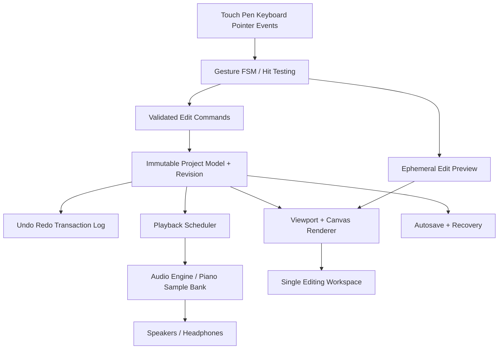

# 04 — 技術設計 / Technical blueprint

**状態:** v0.1設計を保持。実装時の採否・変更・検証は [09_DESIGN_DECISIONS](09_DESIGN_DECISIONS.md) と [10_VALIDATION](10_VALIDATION.md)。以下の「候補」は設計時の記録。

## 1. 想定プラットフォーム

- 第一候補: **TypeScript + Web/PWA**。Android／iPadOS／Windowsなどで動かせるが、端末間でオーディオレイテンシ、ファイルアクセス、オフライン動作の差が出る。サポート範囲は実機検証で確定。
- UI候補: Reactなどの宣言的UIはヘッダーや設定に使用。**高頻度ピアノロール表示をUIフレームワークの再レンダリングへ依存させない**。
- ピアノロール描画候補: Canvas 2D（まず試作し実測）、必要なら WebGL 等を検討。最初から複雑なGPU描画基盤を採用しない。
- オーディオ: Web Audio API、可能ならAudioWorkletによる発音・ミキシング経路。音源ライブラリは実験で選定。
- 保存: IndexedDBのトランザクション、必要に応じてOPFSで大規模素材を保管。オンライン同期は初期版では非対象。

## 2. レイヤー構造



- 操作処理、描画、音声、保存は依存方向を一方向に制限する。
- 視点移動は現在のノート確定・保存・音源処理を待たず、直近の描画結果に座標変換を適用する。
- ノート変更はRevision付きで1回だけ適用。遅れた非同期通知が最新状態を上書きしない。
- ノートの空間インデックスは表示ヒット判定のために使うが、ズームしただけで曲データを書き換えない。

## 3. 正規データモデル（案）

外部公開APIではなく内部設計の概形。**時刻は浮動小数の秒ではなく音楽tickで保持**して、編集・保存を決定的にする。初期候補は960 PPQ。高分解能の演奏入力／MIDI読込による誤差を検証し確定する。

```ts
type ID = string;
type Tick = number; // validated finite safe integer
type Velocity = number; // MIDI compatible: 1..127

interface Note {
  id: ID;
  partId: ID;
  startTick: Tick;
  durationTick: Tick; // > 0
  pitch: number; // MIDI pitch 0..127
  velocity: Velocity;
  channel?: number;
}

interface Part {
  id: ID;
  name: string;
  role: "melody" | "accompaniment" | "inner" | "other";
  hand: "right" | "left" | "unspecified";
  colorKey: string;
  mute: boolean;
  solo: boolean;
}

interface TempoEvent {
  tick: Tick;
  bpm: number;
}
interface PedalEvent {
  tick: Tick;
  value: number; // 0..127 sustain controller
  partId?: ID;
}
interface MeterEvent {
  tick: Tick;
  numerator: number;
  denominator: number;
}

interface Phrase {
  id: ID;
  name: string;
  noteIds: ID[];
  parentPhraseId?: ID; // later V1 relationship
}

interface Project {
  schemaVersion: number;
  id: ID;
  name: string;
  ppq: number;
  revision: number;
  parts: Part[];
  notes: Note[];
  tempos: TempoEvent[];
  meters: MeterEvent[];
  pedals: PedalEvent[];
  phrases: Phrase[];
  updatedAt: string;
}
```

- ノートはstable IDで管理。ピアノロールの表示状態はProjectから分離。
- 小節はテンポ／拍子から算出する表示概念であり、ノートを小節ごとの配列へ閉じ込めない。
- グループは所属IDで保持し、複製・元案と変奏の関係も後から追加できる。
- 保存ファイルにはバージョン番号を入れ、移行処理と未知属性の取り扱いを設計する。
- MIDI音高／ベロシティ範囲、負のtick、ゼロ長、重複ID、孤立したpart参照をバリデーションする。
- 連続ペダル／複数テンポは時間順の明示イベントとして記録する。

## 4. 操作と履歴の整合性

```ts
type EditCommand =
  | { kind: "insertNotes"; notes: Note[] }
  | { kind: "deleteNotes"; noteIds: ID[] }
  | { kind: "moveNotes"; noteIds: ID[]; deltaTick: Tick; deltaPitch: number }
  | { kind: "resizeNotes"; noteIds: ID[]; deltaDuration: Tick }
  | { kind: "setVelocity"; noteIds: ID[]; velocity: number };

interface EditTransaction {
  id: ID;
  baseRevision: number;
  command: EditCommand;
  inverse: EditCommand; // or reversible prior-state snapshot
}
```

- ノートが音域0〜127からはみ出る操作は事前に拒否／プレビュー表示する。曖昧な自動折り返しをしない。
- 1つのドラッグ=1つのUndo履歴。ドラッグ中の全フレームを履歴登録しない。
- プレビューはモデルに混ぜず、`pointercancel` 時に破棄。
- UndoでRedoスタックが生成、確定済みの新編集でRedo枝が消える。V1の「別案」はUndoとは別管理。
- 保存状態は確定revisionのみ。プレビューを作品へ書き込まない。

## 5. 低遅延な映像と音

**描画経路:** pointer event → 入力判定 → 表示用ノートまたはviewport transform更新 → 次フレームに描画。保存や音源ロードのPromiseを待たない。

**音声経路:** UIから時刻を渡す → 演奏スケジューラ → WebAudio/AudioWorklet → 出力。オーディオクロックに基づいて先読みし、毎音のタイマー待ちで再生しない。

- 再生中にProject revisionが変わった場合、新しいノート発音予定を更新。すでに鳴っている音の停止・維持規則を選定し、連打や二重発音を防ぐ。
- ユーザーがノートを置いた際のプレビュー発音は再生スケジュールとは別に即時要求を送信。
- 音源の初回ロード時に音声が出るまでの時間・メモリ消費を測定。未ロード音色を同期読み込みしてUIを停止しない。
- バックグラウンド移行／復帰、オーディオコンテキスト停止、Bluetooth機器による遅延変動も試験する。
- **ゼロ遅延・絶対無停止は実機測定前に保証しない。** 可視応答と音のタイミングを分離して測る。

## 6. SF3音源の取り扱い

以前提供された `MuseScore_General_Full.sf3`（約86MB）を初期の**候補音源**として想定。v0.2では元SF3全体は追加せず、ファイル内のMIT許諾を確認した上でピアノ抽出サンプルと権利表示だけを `public/piano/` に同梱した。判断根拠は09を参照。

導入ゲート:
1. 当該ファイル固有のライセンスと再配布条件、必要な表示義務を確認。
2. SF3対応の再生エンジン候補を用意し、ピアノプリセットの品質を実聴評価。
3. Androidタブレット／iPadで、起動時メモリ、初回発音、同時発音、ペダル、残響、CPU負荷を測定。
4. 86MBを一括で読み込むか、ピアノサンプルのみ取り出して最適化するかを比較。加工・再配布はライセンスに従う。
5. MIDIエクスポート時は音源に依存しない標準ノート／制御イベントを出力。

音色一覧の中にピアノ以外が含まれていても、初期UIはピアノ専用とする。

## 7. 永続化・復旧

- 編集トランザクションの後に自動保存を遅延実行するが、現在の画面操作はブロックしない。
- 保存対象revisionが古ければ破棄し、最新revisionへの更新を行う。
- 保存スナップショット＋復旧用の確定履歴（必要最小限）を備え、クラッシュ時の最後の整合状態へ戻せるようにする。
- 保存に失敗したら画面に明示。失敗を隠して「保存済み」と表示しない。
- エクスポートはユーザーが明示実行。MIDIファイルに未確定編集を混入させない。
- データは端末ローカルを基本。インターネットへ自動送信しない。

## 8. 技術選定の決め方

**必須の試作比較:** Canvas2D vs WebGL、SF3再生方式候補、IndexedDB vs OPFS併用。比較指標は初回ロード、再生遅延、入力可視遅延、CPU／メモリ、低性能端末、実装と保守の複雑性。速さの根拠なく複雑な仕組みを選ばない。
