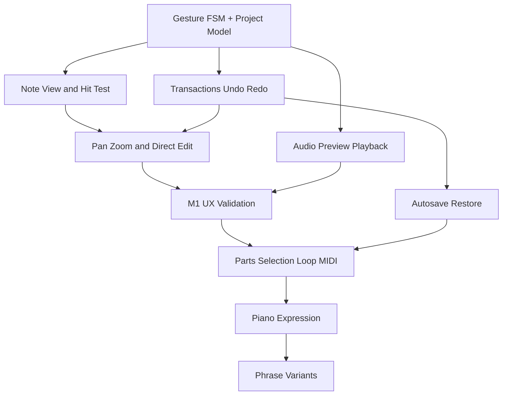

# 05 — 段階的開発計画 / Delivery roadmap

v0.1時点の段階計画を保持。v0.2の機能実装は [08](08_IMPLEMENTATION_STATUS.md)、実測結果は [10](10_VALIDATION.md)。各段階の実機・初見ゲートが通るまでは正式合格とはしない。

## M0 設計と競合の検証（現フェーズ）

**成果物:** README、製品仕様、ジェスチャー契約、UI構造、データ／音声／保存案、QA計画、100課題追跡表。

**判断ゲート:** 重要な操作の衝突が仕様書で解消されていること。実装前に最大リスクの「音符タップ削除vs選択」「2本指介入」「短い音符の伸縮」をプロトタイプ対象として明記。

## M1 ワンループ・プロトタイプ

作るのは見栄えだけの画面ではなく、**4小節の入力→編集→再生→Undo**が繋がる最小実動作版。

- 横向きタブレットに主作曲画面。
- ノートのタップ追加・削除、ドラッグ移動、伸縮。
- 空白パン、2本指パン／ズーム、長押し複数選択。
- シンプルなピアノ音色で再生・即試聴。
- Undo/Redoとモデルのrevision管理。
- 指が触れたときの視覚反応、短い音符の選択補助。

**合格条件:** 主要操作に無反応や二重確定がなく、試験シナリオS1/S4/S5の操作部分が成立。音源はこの段階では検証用の軽量音源でも可。

## M2 作曲できるMVP

- 複数声部、ノート複数選択、コピー、部分ループ。
- テンポ／拍子設定、拍吸着・非吸着。
- 作品一覧、堅牢な保存／復元、自動保存表示。
- MIDI入出力（対応する情報・制限を明記）。
- 主要タブレット実機での音声動作と性能確認。

**合格条件:** 1〜2分程度のピアノ曲を作成・修正・保存・再開・MIDI出力でき、再取込で主要ノート情報が維持される。

## M3 ピアノらしさを完成するV1

- 左右の手、旋律・伴奏・内声の扱い。
- 強弱・ペダル、複数テンポなどの演奏表現。
- 和音の転回・ボイシング補助。
- セクション／フレーズの編集、アイデア置き場。
- 選定したピアノ音源の品質・配布条件の検証。

**合格条件:** 表情のあるピアノ曲を作れ、ペダル／強弱編集が正しく再生・復元される。

## M4 差別化・試行錯誤支援

- フレーズの別案、A/Bの即切替試聴。
- 元案と変奏を保ったリンク複製。
- 音楽的な変形操作、演奏可能性の補助。
- ユーザーテストを受けた導線短縮、操作誤りの改善。

**合格条件:** 通常の曲編集と高度な作曲支援が、同じ基本操作規則上で共存する。

## 実装優先順位と依存関係



**原則:** M1の操作体験に未解決の衝突がある限りM3/M4の機能追加へ進まない。反対に、表面的なアニメーション・音色追加だけでM1を合格にしない。

## バックログ採否の判定

機能要求が来たら、①どんな作曲目的を解決するか、②既存操作で実現可能か、③新しいモードを必要とするか、④誤操作が増えるか、⑤端末負荷と保守コストはどうか、⑥必須実機試験は何か、を記録。複雑化する新ジェスチャーより、既存の対象操作の拡張を優先。

## リポジトリ構成（設計時点）

```text
README.md
docs/
  01_PRODUCT_SPEC.md
  02_INTERACTION.md
  03_SCREEN_DESIGN.md
  04_TECHNICAL_DESIGN.md
  05_ROADMAP.md
  06_TEST_PLAN.md
  07_100_PROBLEMS.md
```

v0.2で `src/`, `public/`, `tests/`, `scripts/`, `qa/`, `.github/workflows/` を追加済み。
