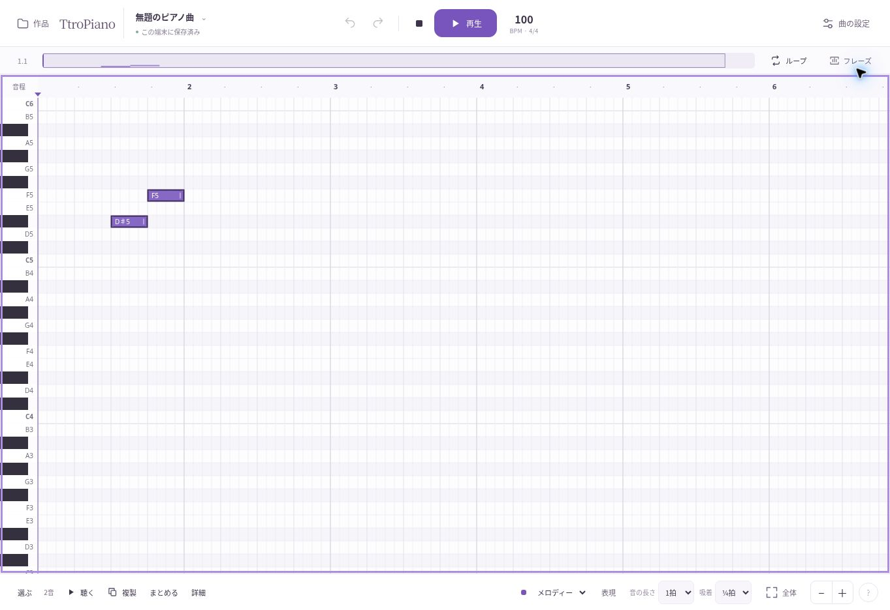

# 14 — GitHub Pages公開

2026-10-25 JST。「Git hubで公開して」の指示に対応。GitHub Pagesへの公開状況を、既存の別ホストでの公開と区別する。

**公開URL：https://totoro0419.github.io/TtroPiano/**

## 最新の公開状態（2026-10-25）

- 最新の配信：`gh-pages` コミット `b46cc69281192e04b4d739c24e953c044edcf6cf`、[Pagesデプロイ成功](https://github.com/totoro0419/TtroPiano/actions/runs/40183371251)。
- [release.json](https://github.com/totoro0419/TtroPiano/blob/gh-pages/release.json) のソースコミットは `61ab29d83ae5d3bcc0711bc1a822af64826bc76a`（スタート画面PR #4）。[そのCI](https://github.com/totoro0419/TtroPiano/actions/runs/40183140754) のテスト・ビルド・本番ブラウザー試験は成功。
- PR #1〜#4は順次マージ済み。`main` への統合コミットは `83196f4fb0ce757e8746074c852a5928f73c104e`。
- 現在のPagesの配信元は従来どおり `gh-pages`。`main` からの新しいActions直接デプロイはSourceの方式が違うため失敗した。既存のブランチ配信とは分けて扱う。設定を変更するまで、Actions直接デプロイは手動起動のみとする。
- 最新版をGitHub Pages上で物理タッチ/OSインストール/実音まで再検証したものではない。以下の旧版検証と区別する。

後続のメニュー・画面切り替え改善も公開済み。最新リリースと検証は [15 — 画面切り替えとアプリメニュー](15_APP_SHELL.md) を参照。以下は初回公開時の記録。

GitHub Pagesのデプロイ成功と、公開URLでの実動作確認が完了した。[公開ワークフロー](https://github.com/totoro0419/TtroPiano/actions/runs/40171519097) は2026-10-25 16:06:43 JSTに成功。利用者のPages有効化後、GitHub APIの `has_pages: true`、公開コミット、配信URLを確認した。

## 公開対象

- 公開専用ブランチ：[gh-pages](https://github.com/totoro0419/TtroPiano/tree/gh-pages)
- 公開用コミット：`932c3fa7f321e264087199b7424935c010db8ac5`
- 公開用tree：`2cba6264cf92302b429283bc28da18c11572aa99`
- 元ソース：`4250908a772d920269c2409c64cebf6487127ef6`
- 検証済みアプリコード：`7a8e611360545be288d97e81df7f74e4fc5d5be8`
- [CI：単体16件・本番ブラウザー8試験PASS](https://github.com/totoro0419/TtroPiano/actions/runs/40170722553)

元ソースと公開ファイルの対応は公開ブランチの `release.json` にも記録。作品データや認証情報を含めていない。ソースの全面置換、既存PRのマージ、`main` の変更は行っていない。

## 準備と有効化

`npm run build` を実行し、PWA・40個のピアノMP3・ライセンス・アプリ本体を公開ブランチのルートへ保存した。`.nojekyll` を追加し、生成済みファイルをそのまま配信する。GitHubのtreeを再取得し、57ファイルが存在し、ビルドしたファイルのGit blob hashと一致することを確認した。

GitHub Pagesを有効にする設定：

1. リポジトリの **Settings → Pages** を開く。
2. **Source: Deploy from a branch** を選ぶ。
3. **Branch: gh-pages**、**/(root)** を選び **Save**。

利用中のGitHub連携にはPages設定を変更する操作がない。ブラウザーの設定画面は未サインインで404になり、Sign inの入口を表示したため、安全な認証手順を開始した。GitHubの端末メール認証に進んだが、認証要求が完了せず中断した。Pages設定は変更していない。公開用ブランチが存在することだけを、Pages公開成功とは扱わない。

その後、利用者から公開済みとの連絡があり、APIと公開ページで確認した。**公開ファイル保存PASS／Pages有効化PASS／デプロイPASS／公開URLでの起動PASS**。

## 公開URLのブラウザー試験

| 項目 | 結果 | 実施内容 |
|---|---|---|
| 編集画面起動 | PASS | ログイン不要でGitHub Pages配下のアプリが表示された |
| 音符入力・自動保存 | PASS | 2音を入力し、全選択で「2音」、この端末に保存済みの表示を確認 |
| 再生開始・停止 | PASS | 再生ボタンが一時停止・aria-pressed trueへ変化し、停止できた。物理スピーカーの出音は未確認 |
| 再読込後の作品復元 | PASS | 再読込後の全選択でも「2音」。保存状態を維持 |
| PWA・音源のキャッシュ準備 | PASS | 設定画面に「オフライン準備完了・ピアノ音源も保存済み」 |
| GitHub Pages上での実ネット切断 | 未確認 | 今回の公開確認ではネットワークを切断していない。CIのルート配信での試験とは区別 |
| OSへの実インストール | 未確認 | Android/iPad/Windows実機では試験していない |

画面写真は公開URLで今回取得したもので、ローカル開発画面の再利用ではない。[機械可読の確認記録](evidence/github-pages-preparation.json)。

## PWAとパス

Viteの `base: './'`、manifestの `id/start_url/scope: './'`、Service Workerの自身のURLからのルート解決を維持。実際に `/TtroPiano/` 配下で起動・保存・キャッシュ準備を確認した。ルート配信でのオフライン回帰試験PASSを、GitHub Pages配下での実ネット切断試験PASSへ読み替えない。

Android/iPad/Windows実機へのインストールと物理端末の出音・指操作は未確認。

将来 `main` への取り込み後にGitHub Actionsから自動配信する場合は、PagesのSourceをGitHub Actionsへ変更して既存の `.github/workflows/pages.yml` を使う。現在は未マージの実装を `gh-pages` から配信する構成。
