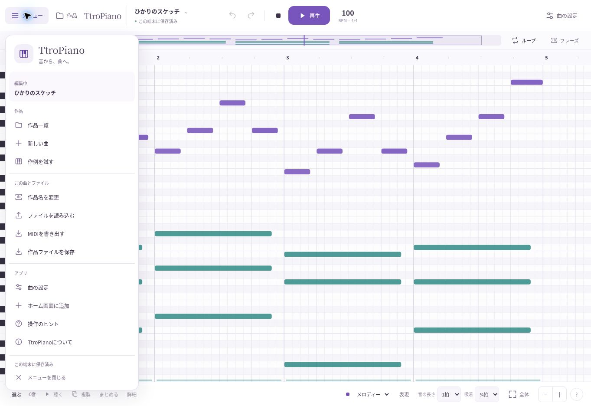
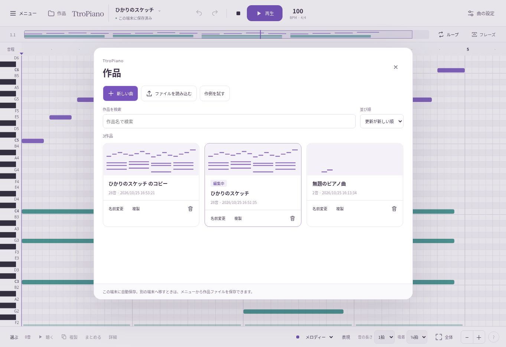

# 15 — 画面切り替えとアプリメニュー

2026-10-25 JST。公開版の元ソース `b890353e6caeed3353b859a6406caaa9afe01eb0` から分岐。既存PRはマージしない。

## 対象と原因

主作業は音符入力・修正・試聴。作品や設定を開くときにも編集位置と保存状態を保ち、切り替え時の空白をなくす。

コードで確認した問題：

- `PianoRoll.resize()` はサイズが同じ場合もキャンバスのwidth/heightへ書き込み、内容を消していた。ResizeObserverからの再描画を次のrequestAnimationFrameへ送るため、描画前の空のビットマップが提示されうる。属性の書き込みがコンテキストをリセットする動作は [HTML Standard](https://html.spec.whatwg.org/multipage/canvas.html) と [MDN](https://developer.mozilla.org/en-US/docs/Web/API/HTMLCanvasElement/width) を参照。
- 作品一覧は複製・改名・削除のたびにclose→非同期保存/再取得→showModalを繰り返していた。
- 作品を開くとき、一覧を先に閉じ、保存待ち後に作品を切り替えていた。作例の表示調整も次フレームへ送っていた。

UI品質の判断には `STATE.01`、`ASYNC.01`、`DATA.01`、`DATA.06`、`FOCUS.01`、`FOCUS.05`、`COMMANDCORE.01`、`VERIFY.02/06/08` を適用。これは全面的なアクセシビリティ適合認証ではない。

## 変更

- 同じサイズへのキャンバス再初期化を省略。実際にリサイズするときは、そのResizeObserver処理内で描画まで完了する。
- 作品一覧を一度開いたまま更新。検索・並び順・スクロールを維持し、作品IDをキーにカードを更新する。複製先や改名した操作へフォーカスを戻す。
- 一覧を開くとすぐ読込中を表示。失敗時は内容を維持し、再読込できる。閉じた後の古い非同期結果で一覧を再表示したり、開こうとしていた作品へ突然切り替えたりしない。
- 作品と視点を描き終えてから一覧を閉じる。画面全体をフェードさせる演出は追加しない。ダイアログ背景のぼかしも外す。
- 左上にアプリメニューを追加。作品・曲とファイル・アプリの3群から、既存機能へ進める。作品一覧・再生・Undo・曲の設定の直接入口は残す。極小幅では作品の入口をメニュー内へ寄せる。
- メニューは表示状態・対象の作品名・保存状態を伝え、矢印/Home/End/Enter/Escape/Tabで操作できる。閉じるボタン、外側、起点ボタンの再押下でも閉じられる。
- 作品一覧に名前検索、更新順/名前順、編集中の表示、空検索と再試行を追加。

メニューはコマンド用のARIA menuを採用。常駐サイドバーは作曲領域を狭めるため採用しない。頻繁な編集操作をメニューへ移していない。

## 検証の記録

2026-10-25 16:46 JST、[最終CI](https://github.com/totoro0419/TtroPiano/actions/runs/40173961057)で **単体16件・本番ブラウザー13試験すべてPASS**。検証済みコードは `d9521aaf5b655e3ec3552572ad06ded0cd4d132d`、tree `9fae4d536dbc942bb67fe1283d407af257fd8601`。既存8試験と以下5試験を実行した。

1. 旧公開版と変更版で、ResizeObserverの描画前ピクセルと作品一覧のopen属性の除去を比較。
2. メニューのキーボード・外側閉じ・設定/ヘルプ・実ファイル書き出し・作曲領域の寸法。
3. 一覧の検索・並び替え・DOM維持・改名・複製・作品切り替え・再読込後の復元。
4. 読み込み失敗後の再試行、遅延中に一覧を閉じた後の安全性。
5. 320/390/768/1024/1366pxの表示と、操作文字を大きくした状態。

| 比較対象 | 旧公開版 | 変更版 |
|---|---:|---:|
| パネル6往復＋縦横切替時の観測 | 13回 | 13回 |
| 空の黒いキャンバスを観測 | 12回 | 0回 |
| 作品複製時のモーダルopen属性除去 | 1回 | 0回 |

これはResizeObserverの描画前にキャンバスの左上のピクセルを検査した結果で、人の知覚時間の測定ではない。背景やノートをフェードで隠して合格させていない。

- [比較生データ](evidence/shell-before-after.json)
- [幅別の矩形・大きい操作文字](evidence/navigation-layout.json)
- [CIの全13結果と成果物SHA-256](evidence/shell-ci.json)

作品一覧の改名・複製だけでなく、現在の作品の削除→再読込後に削除済みの作品が復活しないこと、削除キャンセル、読み込み失敗からの再試行、読み込み中の閉じる操作も実行した。メニューから新しい曲を作った後も元の作品が一覧に残ること、作品ファイルの実ダウンロードも確認した。

初回CIは12/13 PASSで、旧版のcloseイベントを待つ比較だけFAILだった。closeイベントはキューに遅れて届くため、実際のopen属性除去をMutationObserverで記録する方法へ変更し、その後2回の全13試験でPASSを確認した。成功した最終試行の生データを採用した。

## GitHub Pages

[公開アプリ](https://totoro0419.github.io/TtroPiano/)、[改善PR #3](https://github.com/totoro0419/TtroPiano/pull/3)。PR #1/#2/#3はマージしていない。

公開用コミット `fb9edb03b61acc8b9de357cde7757dd42277fb15`、tree `4a34c9d97732d97c57d07146b3f2b59eba1cbeeb`。PWAとピアノ音源を含む57ファイルを保存して元ビルドと照合し、[Pagesデプロイ](https://github.com/totoro0419/TtroPiano/actions/runs/40174177107)の成功を確認した。Service Workerキャッシュは `7e57db9c5472a087`。

すでに旧版を開いていた場合は、新しいService Workerの準備後、そのURLのタブとPWAを閉じて開き直すと更新される。作品の保存領域やIDを変更せず、キャッシュ削除を要求しない。

公開URLを通常の手順で開き直し、新版のメニューを確認。更新前に保存した2音を引き継いだまま、メニューから4小節28音の作例を開き、再生開始/停止、作品一覧で検索（2作品→1作品）、一覧を開いたまま複製（2作品→3作品）、元の2音の作品へ戻る操作を実行した。設定の「オフライン準備完了・ピアノ音源も保存済み」も確認した。

[公開URLの確認記録](evidence/shell-live.json)。取得したエラー/警告ログ46件はブラウザー拡張のメタデータ送信エラーで、アプリ配信元のエラーは観測しなかった。拡張の問題をアプリの不具合と混同していない。

開発用プレビューへの接続は自動操作ブラウザーの `ERR_BLOCKED_BY_CLIENT` で実行不能。別経路で回避せず、CIで本番ビルドを検証し、公開後はGitHub Pagesの独立した公開URLで確認する。

実機でのちらつき・指操作・支援技術・OSの文字サイズ設定は未確認。ピクセル試験だけを人の知覚や全端末での無ちらつきの保証にはしない。
